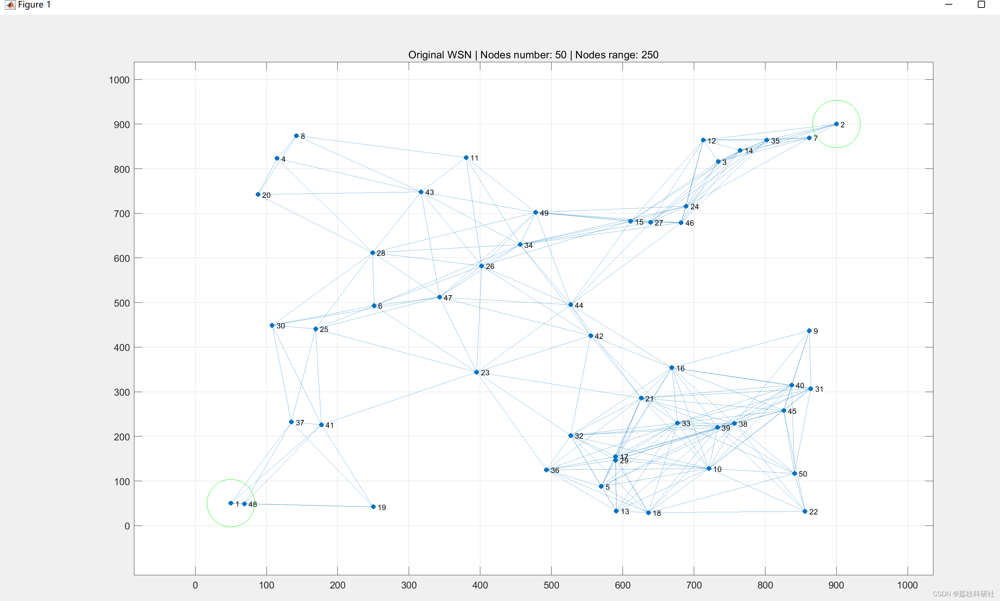
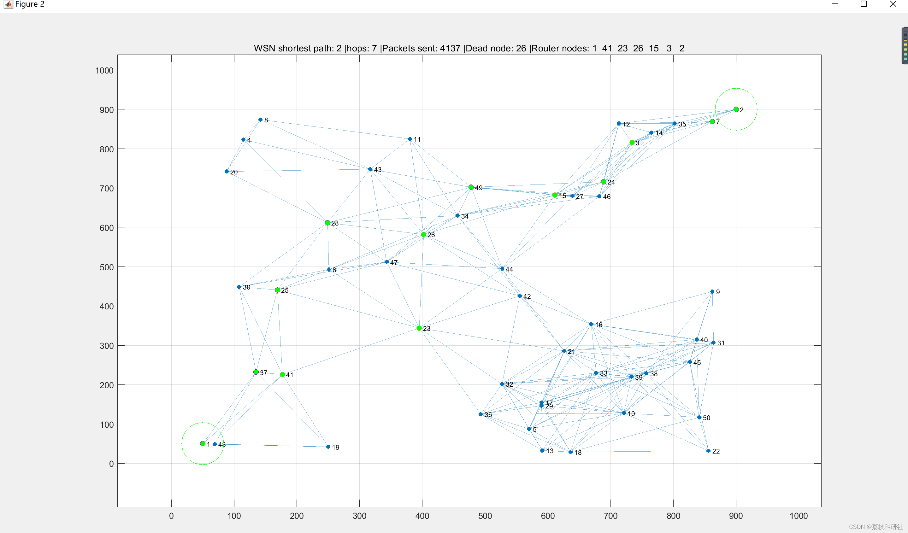
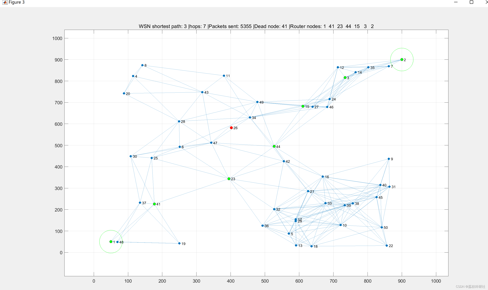
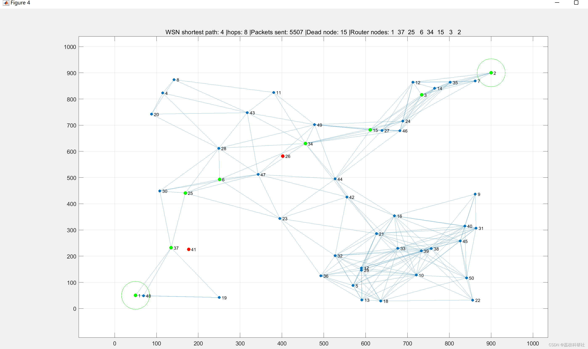
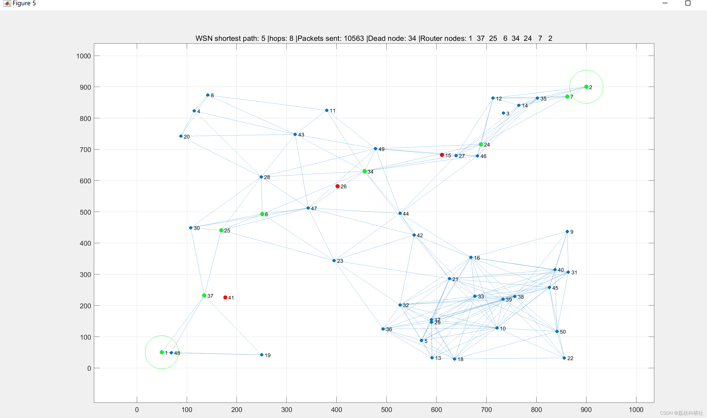
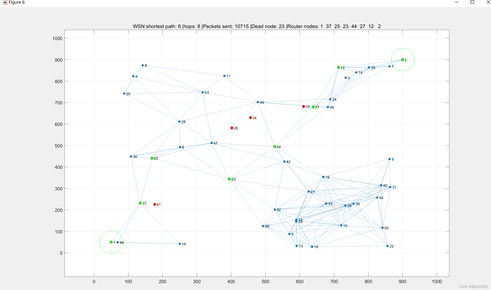
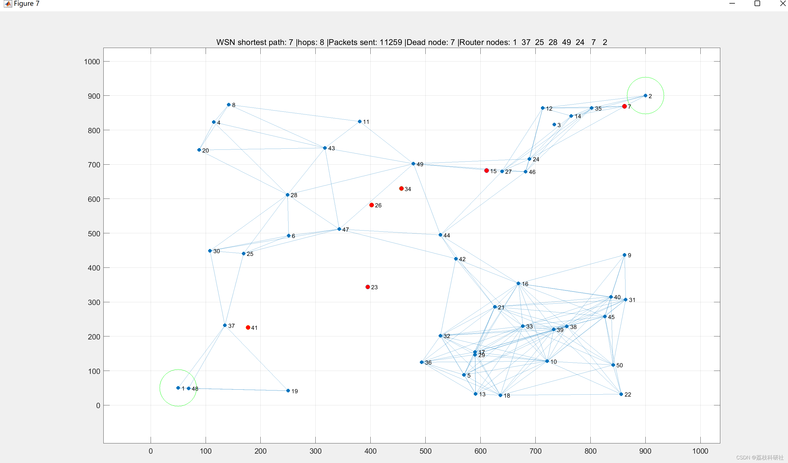
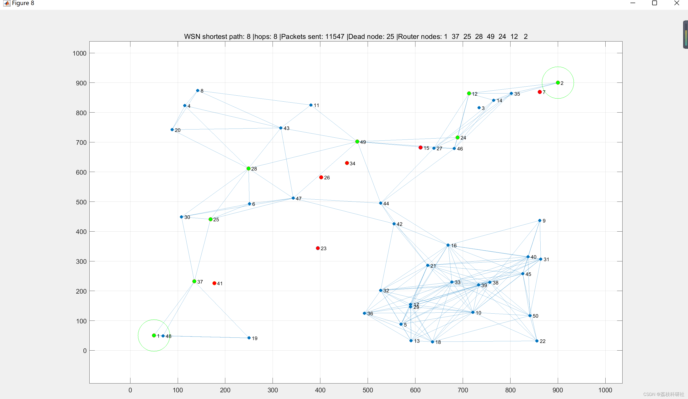
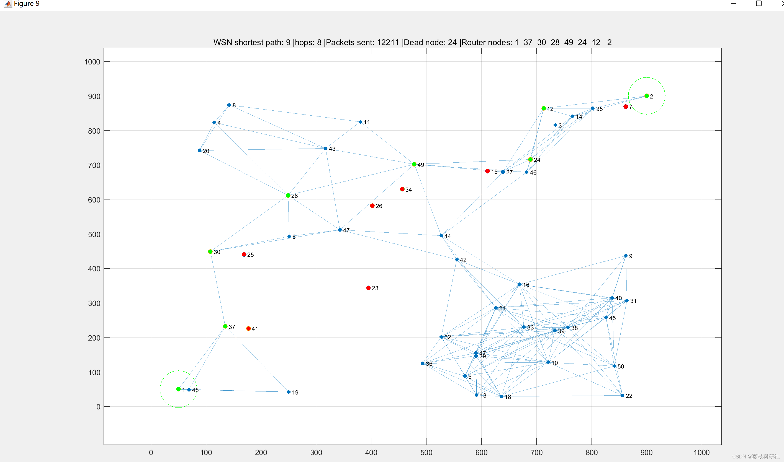
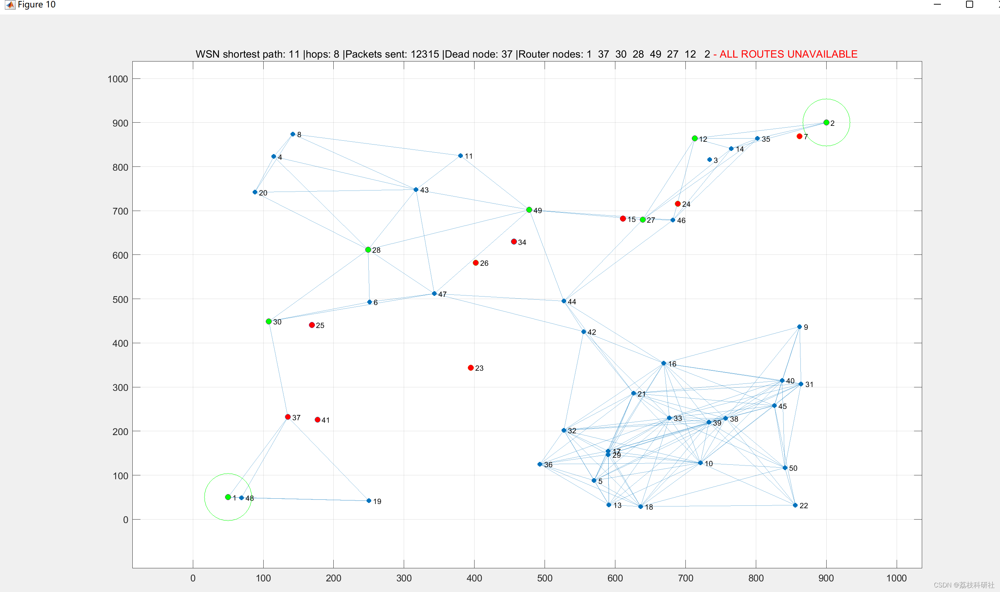

# [Wireless Sensor Network]Find the shortest path between two nodes and send data (Matlab code implementation)

[Wireless Sensor Network]WSN Finds the Shortest Path Between Two Nodes and Sends Data (Matlab Code Implementation)

The WSN has a range tolerance between nodes (you can choose the range in meters). Once nodes establish connections, appropriate range tolerances are randomly assigned within a 1km x 1km terrain. The shortest path algorithm retrieves routes and begins sending data from node 1 (source) to node 2 (target), until any node involved in the route due to energy failure (all nodes involved in the route will reduce their energy - also randomly defined). After a route fails, it gets the next shortest route and continues sending. This process continues until there is no path between the source and target.
📚2 Run Results Edit

Edit
Edit
Edit
Edit
Edit
Edit
Edit
Edit
Part of the code:
% Edges matrix definition based on "range" variable value
dataset.weights = lt(dataset.euclidiana, dataset.range);
% Graph construction
G = graph(dataset.weights, 'omitselfloops'); % Graph creation based on adjacency matrix (Edges matrix) built above
% Euclidean distance extraction for all existing end-to-end formed by
% "distance tolerance" (range variable value)  
for a = 1 : height(G.Edges)  
garbage.s = G.Edges.EndNodes(a,1);  
garbage.t = G.Edges.EndNodes(a,2);  
garbage.Z(a,:) = dataset.euclidiana(garbage.s,garbage.t);  
end  
G.Edges.Euclidiana = garbage.Z(:,1);  
%Initial energy sortition (from 70% to 100% - minEnergy and maxEnergy variable valeu)  
[dataset.nodePosition(:,4)] = dataset.maxEnergy -(dataset.maxEnergy-dataset.minEnergy)*rand(dataset.nodeNo,1);  
dataset.nodePosition(1:2,4)=STenergy;  
%All "G" (Graph object) based nodes degree to use as "node processing  
%status overload" (more connections, busier!)  
for a = 1: length(dataset.nodePosition(:,1))  
dataset.nodePosition(a,5) = degree(G,dataset.nodePosition(a,1));  
end  
% Pathloss calc of each Edges based in a freespace (1.8 factor)  
[G.Edges.Pathloss] = (10*dataset.atenuationFactor)*log10(G.Edges.Euclidiana);  
%End points coordinates and energy migration to G object  
for a = 1 : height(G.Edges)  
garbage.Sourcenode = G.Edges.EndNodes(a,1);  
garbage.Targetnode = G.Edges.EndNodes(a,2);  
G.Edges.SourcenodeXpos(a) = dataset.nodePosition(garbage.Sourcenode,2);  
G.Edges.SourcenodeYpos(a) = dataset.nodePosition(garbage.Sourcenode,3);  
G.Edges.TargetnodeXpos(a) = dataset.nodePosition(garbage.Targetnode,2);  
G.Edges.TargetnodeYpos(a) = dataset.nodePosition(garbage.Targetnode,3);  
G.Edges.ActiveEdge(a) = 1;  
end  
% Graph objects plot  
figure('units','normalized','innerposition',[0 0 1 1],'MenuBar','none')  
subplot(1,1,1) %1,3,1 (Line number,collumn number, graph id) - if you want to show more than 1 graph in same windows  
garbage.Xmax = 1500;  
garbage.Xmin = 0;  
garbage.Ymax = 1500;  
garbage.Ymin = 0;  
p = plot(G,'XData',(dataset.nodePosition(:,2)),'YData',(dataset.nodePosition(:,3)));  
line(dataset.nodePosition(1:2,2),dataset.nodePosition(1:2,3),'color','green','marker','o','linestyle','none','markersize',50)  
garbage.ax = gca;  
garbage.ax.XAxis.TickValues = 0:100:1000;  
garbage.ax.YAxis.TickValues = 0:100:1000;  
grid on  
hold on  
title(['Original WSN | ','Nodes number: ',num2str(dataset.nodeNo),' | Nodes range: ', num2str(dataset.range)])  
pause(2)  
%Creation of some stuff needed  
garbage.deadnodelist=[];  
garbage.deadnodeneighbors=[];  
%% finding routes  
% Finding shortest path route  
G2 = shortestpathtree(G,1,2);  
%% Initialize patch existance test for loops  
fileID = fopen('report-noACO-simulation.txt','w'); %Open file to collect data to external file  
fprintf(fileID,'%6s %20s %20s %20s %20s\r\n','|NodeNo|','|No ACO Scene|','|Hops|','|Packets sent|','|Dead node|');  
while ~isempty(G2.Edges)  
G2 = shortestpathtree(G,1,2);  
iterationcounter=iterationcounter+1;  
% Test if there is connection between node 1 and 2. If not, terminate!  
if isempty(G2.Edges)  
    break  
end  
🎉3 References  
🌈4 MATLAB Code Implementation

## Images

<!-- PAYMENT_BLOCK -->

## Get this dataset

- Payment link (Stripe): [Buy now](https://buy.stripe.com/3cs8yP7sY87d0vu9AB)
- Payment QR code: 

<!-- /PAYMENT_BLOCK -->
